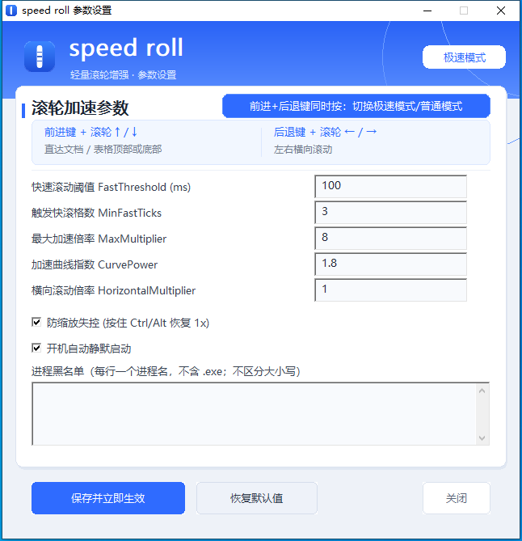

# speed roll

speed roll 是一个纯原生 C++17 / Win32 API 编写的轻量级 Windows 鼠标滚轮增强工具。它用低层鼠标钩子实现滚轮变速、侧键复用、无焦点 Toast 和系统托盘黑名单，不依赖任何第三方 DLL。




## 运行

- 双击 `speed roll.exe`：静默启动到系统托盘，不显示主窗口。
- 托盘图标悬停：查看当前模式/状态。
- 托盘图标双击：打开参数设置。
- 托盘图标右键：打开动态菜单。

## 界面

- 蓝色渐变标题栏、圆角白色参数卡片和强调色操作按钮。
- 极速/普通模式以标题栏右侧徽标显示，并随模式切换刷新。
- 参数卡片顶部提供“前进键 + 滚轮”“后退键 + 滚轮”的动作说明。
- 使用蓝色高亮胶囊显示“前进+后退键同时按：切换极速模式/普通模式”。
- 参数标签、输入框、复选框和黑名单均支持暗色鼠标悬停说明。
- 托盘和窗口使用新的蓝色圆角滚轮图标。

## 双模式

- **普通模式**：完全原生的 1:1 滚轮。不拦截、不注入、不加速，无论滚多快都保持单格滚动。
- **极速模式（开机默认启用）**：只有连续同向、快速（单格间隔小于 `FastThreshold`）的滚轮才会累计 `fastStreak`。
  - 出现停顿、慢滚或反向时，`fastStreak` 和余数清零，当格强制 1x。
  - `fastStreak` 达到 `MinFastTicks` 后，才按 `MaxMultiplier` / `CurvePower` 曲线加速。
  - 默认 `MinFastTicks=3`：从静止起步的首格以 1x 重置计数，随后连续同向快滚计数达到 3，即从第 4 个滚轮格开始加速；日常慢滚仍然保持 1x。
- 按住 `Ctrl` 或 `Alt` 时，极速模式也强制恢复 1x，避免缩放失控。

## 快捷操作

| 操作 | 功能 |
| --- | --- |
| 前进键 + 后退键同时按下 | 切换普通 / 极速模式 |
| 按住前进键 + 滚轮向上 / 向下 | 直达顶部（左 Ctrl+Home）/ 底部（左 Ctrl+End），250 ms 防连发冷却 |
| 按住后退键 + 滚轮 | 横向滚动，方向与 Windows 习惯一致，倍率可配置 |
| 单独按前进键 / 后退键 | 原样补发前进 / 后退，保留浏览器和资源管理器行为 |

## 配置

配置文件是与 exe 同目录的 `config.ini`：

```ini
[speed roll]
FastThreshold=100.000000
MinFastTicks=3
MaxMultiplier=8.000000
CurvePower=1.800000
HorizontalMultiplier=1.000000
PreventZoomOverrun=1
GlobalDisabled=0
DisabledProcesses=
```

| 键 | 默认值 | 范围 | 说明 |
| --- | --- | --- | --- |
| `FastThreshold` | `100.0` | 1 ~ 5000 | 单格快滚时间阈值（毫秒）；实际快滚不触发时可适当调大 |
| `MinFastTicks` | `3` | 1 ~ 24 | 触发加速所需的连续快滚计数 |
| `MaxMultiplier` | `8.0` | 1 ~ 100 | 曲线最大倍率 |
| `CurvePower` | `1.8` | 0.1 ~ 10 | 加速曲线陡峭度 |
| `HorizontalMultiplier` | `1.0` | 0.1 ~ 20 | 按住后退键时的横向滚动倍率 |

`DisabledProcesses` 使用分号分隔的进程名（不需要 `.exe`，不区分大小写）。设置窗口中的多行文本框每行填一个进程名即可。

参数设置窗口使用微软雅黑 UI，支持以上数值参数、防缩放失控、开机静默启动和黑名单编辑。鼠标悬停在参数标签、输入框、复选框或黑名单上时，会显示对应中文说明。窗口中的“恢复默认值”会把所有数值参数、防缩放选项和黑名单填回默认值；开机自启是系统注册状态，恢复默认值时保持不变。之后再点击“保存并立即生效”写入配置。保存后会立即生效，并写入 `HKCU\SOFTWARE\Microsoft\Windows\CurrentVersion\Run`（开机自启值名为 `speed roll`，旧版 `WheelAccel` 值会自动迁移）。旧的 `HyperMultiplier` 键会在保存时自动移除。

## 构建

要求 64 位 MinGW-w64（UCRT 或 MSVCRT 均可）或 MSVC。工作区构建脚本默认使用 MinGW：

```powershell
powershell -ExecutionPolicy Bypass -File .\build.ps1
```

脚本会编译、strip，并同时发布一份到同级的 `speed-roll-runtime\speed roll.exe`。也可以直接指定编译器：

```powershell
.\build.ps1 -Compiler C:\path\to\g++.exe -Strip C:\path\to\strip.exe
```

等价的 MinGW 命令：

```text
g++ -std=c++17 -Os -s -mwindows -municode -static -static-libgcc -static-libstdc++ ^
    -ffunction-sections -fdata-sections -Wl,--gc-sections ^
    -o "speed roll.exe" main.cpp ^
    -luser32 -lshell32 -lgdi32 -limm32 -ladvapi32 -lpsapi -lcomctl32
```

## 实现要点

- `WH_MOUSE_LL` 全局钩子；所有模拟输入在 `dwExtraInfo` 中携带 `0x57414343`，钩子检测到后直接放行，避免自触发死循环。
- 模拟鼠标事件不在钩子回调内同步调用，而是 `PostMessage` 到消息循环后执行，避免低层鼠标钩子重入导致的约 300 ms 阻塞。
- 普通模式的滚轮事件直接 `CallNextHookEx` 放行；只有极速模式才累计 `fastStreak` 并可能注入倍速滚轮。
- 前进键 + 滚轮会捕获鼠标下顶层窗口并在注入前置前，然后在独立异步线程中用 `keybd_event` 分步发送 `VK_LCONTROL` + `VK_HOME`/`VK_END`，每步间隔 15 ms，兼容浏览器、WPS、金山文档和 LibreOffice。
- `Home`/`End` 的按下与抬起均带 `KEYEVENTF_EXTENDEDKEY` 和 `MapVirtualKeyW` 扫描码，避免被办公软件误判为小键盘键；`VK_LCONTROL` 最后一定会释放。
- `QueryPerformanceCounter` 计算滚轮间隔；反转、慢滚、停顿或 `Ctrl`/`Alt` 防缩放保护都会清空余数和快滚计数。
- 托盘右键菜单在每次弹出时动态重建，并根据 `lastActiveProcessName`、全局禁用状态和黑名单状态设置勾选项。
- `SetProcessDPIAware()` 适配高分屏；设置窗口和 Toast 均按系统 DPI 缩放。

## 已验证环境

- Windows 11 x64
- MinGW-W64 GCC 16.2.0 (UCRT, POSIX, SEH)
- 生成文件：292,352 字节（285.5 KB / 292.35 KB 十进制）
- 仅依赖 Windows 系统 DLL（USER32、GDI32、SHELL32、ADVAPI32、COMCTL32、IMM32、KERNEL32 及系统 UCRT API Set）；无 libgcc / libstdc++ / winpthread 导入。
- 私有工作集：空闲约 0.12 MB，设置窗口打开约 0.73 MB；私有提交约 1.65–1.94 MB。
